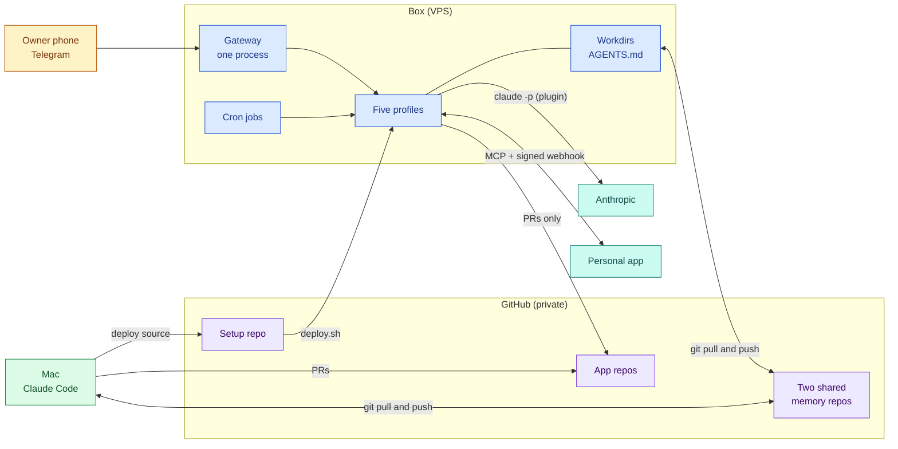

# Hermes Agent architecture: five profiles, two brains, one git memory bus

*A small VPS agent box, a Mac-side Claude Code session and private git repos as their only shared memory.*

## What this is

A public write-up of a real, running personal system. A multi-profile Hermes Agent box on a VPS at about $8 per month is driven over Telegram. A Claude Code session on the Mac does the heavy work. Private git repos are the only memory the two share.

This repo holds documentation, diagrams and sanitised templates. It does not hold the deployed sources. All personal data has been removed.

Colour key: blue = box, green = Mac, purple = GitHub, amber = owner, teal = external services.

## Key ideas

The full reasoning is in [Decisions](docs/07-decisions.md) and [Shared memory](docs/03-shared-memory.md).

- **Two brains, one repo.** A Hermes profile on the box and a Claude Code session on the Mac never talk. They read and write the same private repo.
- **Git is the memory bus.** Ownership is set per file or per section and every line has a strict format, so two writers rarely collide.
- **Prompt memory is tiny and measured.** Memory files are capped at a few thousand characters and make up 1 to 3% of a call.
- **One source of truth, idempotent deploy.** A private setup repo defines every profile and `deploy.sh <profile>` applies it safely on every run.
- **Controls live outside the model.** No sudo for the agent user, deny globs that survive `/yolo`, and a coding agent that can only open PRs.
- **Measure before adding infrastructure.** There is no memory provider and no RAG today, and a retrieval ladder says what to add when evidence demands it.

## By the numbers

| Item | Value |
|---|---|
| VPS | 2 vCPU, 4 GB RAM, about $8 per month |
| Profiles and gateways | 5 profiles, 1 gateway |
| Fixed prompt prefix | about 18k tokens per call |
| Memory files in a call | 1 to 3% |
| Cost, all profiles | about $10.7 list per week (7 days to 2026-10-25) |
| Two-writer git use | 0 merge conflicts, 2 recovered rejected pushes in 5 days |
| External memory providers | 0 |

## Read the docs

Start with 01 for the picture, then 03 for the memory model. Each doc opens with a diagram and ends with the dates of its facts.

| Doc | What it covers |
|---|---|
| [01 Architecture](docs/01-architecture.md) | The box, the Mac, the repos and how a message travels through them. |
| [02 Profiles](docs/02-profiles.md) | Five isolated profiles, each built from one source folder and deployed by script. |
| [03 Shared memory](docs/03-shared-memory.md) | Git as the memory bus, with ownership per file and strict line formats. |
| [04 Workflows](docs/04-workflows.md) | Deploy, research hand-off, engineering hand-off and scheduled jobs. |
| [05 Security](docs/05-security.md) | SSH-only inbound, no sudo for the agent and gates the agent cannot switch off. |
| [06 Token economy](docs/06-token-economy.md) | Where the 18k-token prefix goes and what each profile costs. |
| [07 Decisions](docs/07-decisions.md) | Six ADR-style records and the deferred retrieval ladder. |
| [08 Lessons](docs/08-lessons.md) | What worked, what hurt and what to do on day one. |

## Templates

Sanitised skeletons with `<placeholder>` values. Copy them and fill in your own.

| File | Description |
|---|---|
| [AGENTS.example.md](templates/AGENTS.example.md) | Shared contract for a workdir with one owner section per writer. |
| [cron.example.txt](templates/cron.example.txt) | One cron job per line, applied only if the name does not exist yet. |
| [deploy-contract.md](templates/deploy-contract.md) | The six steps of an idempotent profile deploy as pseudocode. |
| [inbox-conventions.md](templates/inbox-conventions.md) | Line format for an append-only capture file that both machines write. |
| [profile-config.example.yaml](templates/profile-config.example.yaml) | Profile config merged on deploy, with one model for every profile. |
| [SKILL.example.md](templates/SKILL.example.md) | Skeleton of a skill: a Markdown procedure that writes one file. |

## How this was built

The process mattered as much as the design.

- **Design doc per profile.** Each has a dated review log, written before any deploy.
- **Verified facts.** Each design has a section where the box was inspected and versions were pinned.
- **Conventions first.** A shared conventions doc and a deploy contract existed before the second profile.
- **Token audits.** Dated baselines on day 10 and day 18, with decisions recorded from the numbers.
- **Day 18 review.** An architecture and memory-infrastructure review answered "do we need a memory provider or RAG" with evidence.
- **Status log.** Every change to the box is recorded newest-first, appended by both machines.
- **Tooling.** Claude Code on the Mac is the authoring tool. Hermes skills are Markdown procedures with stdlib Python helpers run with `python3 -I`.
- **This write-up.** One orchestrating session and parallel writer subagents worked against a privacy brief. The owner's session then reviewed it line by line before publishing.

## Status

Snapshot as of 2026-10-29. Three profiles are live. Two are deployed and wait on owner secrets.
The open items are listed in [docs/08-lessons.md](docs/08-lessons.md).

## License

MIT, see [LICENSE](LICENSE). No personal data, secrets or private repo content is included, and the profile sources stay private.
