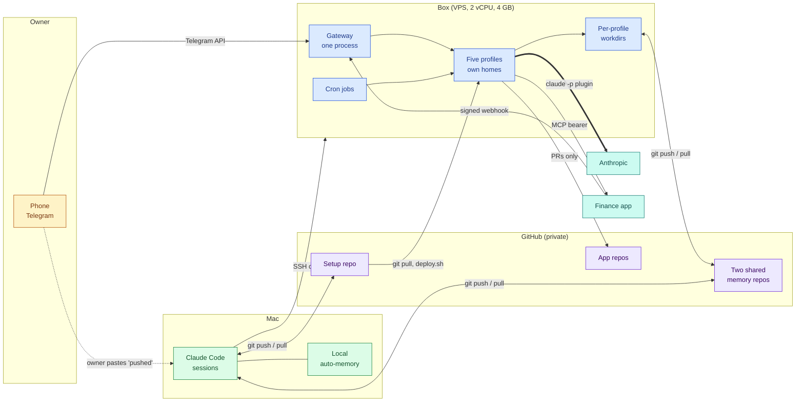
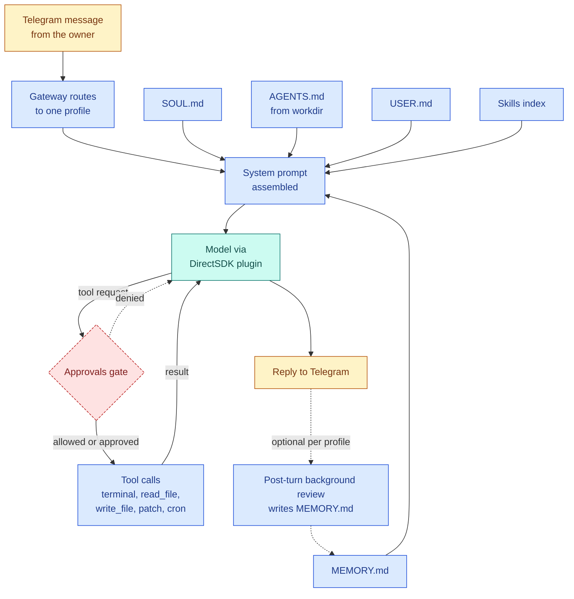

# Architecture

One small Linux box runs a Hermes Agent gateway that serves five profiles over Telegram. A Mac runs Claude Code sessions against the same private git repos. The two sides never talk directly. They read and write the same files and the owner relays "it is pushed" by hand.

Colour key: blue is the box, green is the Mac, violet is GitHub, amber is the owner, teal is a third party.

## Components

A **profile** is a fully separate Hermes home with its own config, secrets, persona, memory, skills and session store. A **skill** is a markdown procedure the agent loads on demand. A **cron job** is a scheduled prompt that runs inside a profile.

| Where | Component | What it does | Facts |
|---|---|---|---|
| Box | VPS, Ubuntu 24.04 | Hosts everything the agent runs | 2 vCPU x86, 4 GB RAM, 2 GB swap, 38 GB disk, about $8 per month, EU datacenter. Inbound: SSH only. |
| Box | Hermes Agent 0.22.x gateway | One multiplexed systemd user service serves all five profiles | Runs as the unprivileged `hermes` user. Idle at rest. Root work goes through a separate `admin` account. |
| Box | Claude Code CLI, logged in to the owner's Max plan | The only model route | Hermes calls the DirectSDK plugin, which calls `claude -p`. Model `claude-sonnet-5-5[1m]` in every profile. All profiles share one 5-hour usage window. |
| Box | Profile home, one per profile | State that belongs to one persona | `config.yaml`, `.env` (mode 600), `SOUL.md`, `memories/MEMORY.md` (2,200 chars), `USER.md` (1,375 chars), `state.db`, `skills/`, `cron/`, `logs/`. |
| Box | Profile workdir, one per profile | A git repo the agent works in | Holds an `AGENTS.md` contract that is read every turn. Two are clones of private repos. Two are local only. |
| Box | Side services | Local tooling for the coding profile | PostgreSQL 16, Node 22, secret and vulnerability scanners, PDF tools. |
| Box | Setup repo clone and crontab | Source of every profile | `deploy.sh <profile>` applies it idempotently. A crontab job fast-forwards three clones every 10 minutes. It skips dirty or diverged clones and logs. |
| Mac | Claude Code sessions | Authoring, ops over SSH, feature work | Sessions run in the setup repo and in the two shared repos. Browser logins, builds and secrets stay here. |
| Mac | Local auto-memory | Per-project notes written by Claude Code | A tier of memory the box cannot see. See [Shared memory](03-shared-memory.md). |
| GitHub | Private repos | Source of truth and shared memory | One setup repo, two shared memory repos, the app repos the coding profile maintains. |
| Telegram | One bot per profile | The owner's UI for the box | Allowlist of exactly one user. In practice also the notification channel between Mac and box. |
| External | Anthropic | Model inference | Billed to the owner's subscription. No API key exists anywhere. |
| External | A personal finance app | System of record for the rewards profile | Reached over MCP with a bearer token. Alerts return as an HMAC-signed webhook. |

## Data flow

The owner talks to the box through Telegram. The box talks to Anthropic through the local `claude -p` process. Files move between machines only as git commits.

| Flow | Path | Direction | Notes |
|---|---|---|---|
| Chat | Phone, Telegram API, gateway | Both | Long polling by the gateway, so nothing listens for Telegram. |
| Inference | Profile, plugin, `claude -p`, Anthropic | Both | Hermes tools do the work. Claude Code's own shell and editor tools are disabled. |
| Shared memory | Workdir clone, GitHub, Mac clone | Both | Ownership is per file or per section. See [Shared memory](03-shared-memory.md). |
| Profile source | Mac authoring, setup repo, box clone, deploy | Mac to box | Skills are overwritten from the repo on every deploy. |
| Code changes | Coding profile, branch, pull request | Box to GitHub | Direct pushes to default branches are refused. The owner merges. |
| Rewards | Profile, MCP, finance app, webhook | Both | The webhook is the one planned inbound path. See [Security model](05-security.md). |
| Ops | Mac, SSH, box | Mac to box | For deploys and audits. The agents never use it. |

No direct application channel exists between the Mac and the box. After a push, the owner pastes a one-line "pushed" message into Telegram. The next cron sync, or an explicit pull, delivers the change. [Workflows](04-workflows.md) walks through the common cases.

## The agent turn inside the box

One Telegram message becomes one turn. The gateway picks the profile from the bot that received the message. It then builds the system prompt from files and sends it to the model.

| Prompt part | Source | Role |
|---|---|---|
| `SOUL.md` | Profile home | Persona and hard rules. |
| `AGENTS.md` | Profile workdir | The contract for that repo. Read every turn. |
| `USER.md` | Profile home | Stable facts about the owner. |
| `MEMORY.md` | Profile home | Short notes the agent keeps. Frozen at session start. |
| Skills index | Profile home | One line per skill. Bodies load on demand. |

The **DirectSDK plugin** is the Hermes provider that shells out to `claude -p`. The **approvals gate** is a Hermes check that runs before a risky command. It can allow, ask the owner in Telegram, or deny. Rules are in [Security model](05-security.md).

Measured on 2026-10-17, the fixed prefix of a call is about 18k tokens. Tool schemas are about 10k, the system prompt about 6k and the Claude Code frames about 4k. Memory files are 1 to 3 percent of a call. [Token economy](06-token-economy.md) has the breakdown.

## Isolation and trust boundaries

- Profiles are isolated homes. Only the Hermes code, the Claude login and one Google token are shared.
- Secrets never leave the box. The repo carries placeholders only.
- The agent user has no sudo. Dangerous commands hit the approvals gate and a deny list.
- Personal data rules differ per profile and are written into each profile's contract.

The full model, with the layer table and the known gaps, is in [Security model](05-security.md). Why each choice was made is in [Decisions](07-decisions.md). What went wrong along the way is in [Lessons](08-lessons.md).

Related: [Profiles](02-profiles.md), [profile config template](../templates/profile-config.example.yaml), [deploy contract](../templates/deploy-contract.md).

## Sources and dates

Facts observed between 2026-10-07 and 2026-10-29. Hardware and firewall facts from 2026-10-16. Component versions and the sync job from 2026-10-25. Token figures from 2026-10-17.
