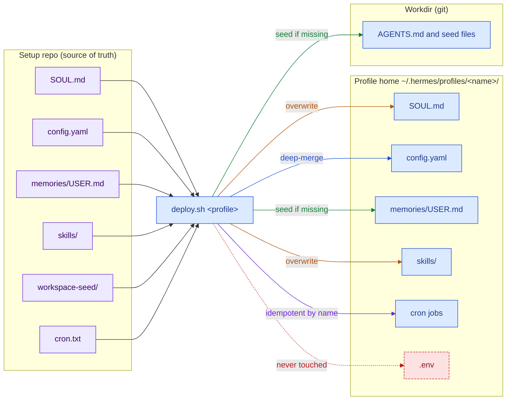

# Profiles

A Hermes profile is a fully separate home: its own config, `.env`, `SOUL.md`, memories, sessions, skills, cron jobs and Telegram bot token. One multiplexed gateway serves all of them. The design keeps five profiles isolated, each with its own Telegram bot, workdir and deny-list. Every profile is built from a source folder in one private setup repo and applied by `deploy.sh <profile>`.

## What a profile is

A profile is a directory under `~/.hermes/profiles/<name>/`. Hermes starts a separate agent context from it. Nothing is shared between two profile homes except what the table in [Isolation](#isolation) lists.

| File or folder | What it does |
|---|---|
| `config.yaml` | Model route, plugins, approvals gate, deferred tools, timezone, working directory. |
| `.env` | Mode 600. Bot token, owner allowlist, app tokens. Never in git. |
| `SOUL.md` | The persona and standing rules. Loaded into every prompt. |
| `memories/MEMORY.md` | Agent-written notes. Capped at 2,200 characters. |
| `memories/USER.md` | Facts about the owner. Capped at 1,375 characters. |
| `state.db` | SQLite with FTS5. Holds sessions for search. |
| `skills/` | Procedures the agent can run, one `SKILL.md` each. |
| `cron/` | Scheduled jobs of this profile. |
| `logs/` | Gateway and agent logs. |

The workdir sits outside the home. It is a git repo with an `AGENTS.md` contract that the agent reads every turn. See [Shared memory](03-shared-memory.md).

## The five profiles

| Profile | Role | Workdir | Shared with the Mac? | Autonomous crons |
|---|---|---|---|---|
| `default` | Plain assistant. | Home directory. | No. | None. It also hosts the webhook routes of the gateway. |
| `career` | Personal career assistant. | Local-only folder. | No. | One weekly digest, paused until its input file exists. |
| `travel` | Travel planning assistant. | Clone of a private repo. | Yes, the same repo is cloned on the Mac. | Per-plan crons: daily brief, milestone reminders. |
| `vibecoder` | Engineer-on-call for the owner's private side-project repos. PR-only. | Clone of a shared engineering-memory repo. | Yes. | Five: discovery, PR digest, health, audit, dependency check. |
| `rewards` | Companion of a personal app of the owner, read over MCP. | Local-only cache folder. | No. | Three (alerts, digest, market watch), paused until the app-side secrets land. |

Each profile has one bot. The allowlist holds the owner only. See [Security](05-security.md) for the deny-lists and the approvals gate. Cron design is in [Workflows](04-workflows.md).

## Anatomy of a profile source

A `profiles/<name>/` folder in the setup repo holds six kinds of source file. Each has its own deploy rule.

| Source file | Deploy rule |
|---|---|
| `SOUL.md` | Copied on every deploy. The repo wins. |
| `config.yaml` | Deep-merged into the live file. Repo keys win. Keys written on the box, such as the bot token, are kept. The previous file is backed up. |
| `memories/USER.md` | Seeded. Kept once its `TODO` markers are filled in. |
| `skills/` | Synced with `rsync --delete`. The repo owns them. `skills.write_approval: true` stages box self-edits for review instead of losing them. |
| `workspace-seed/` | Copied only for files that do not exist yet. Then committed with a dedicated git identity. |
| `cron.txt` | One `cron create` argument list per line. Applied idempotently by job name. |
| `.env` | Never written. Read only to fill placeholders in optional gateway routes. Created on the box by `gateway setup`. |

Templates for these files: [config](../templates/profile-config.example.yaml), [AGENTS.md](../templates/AGENTS.example.md), [skill](../templates/SKILL.example.md), [cron list](../templates/cron.example.txt), [deploy contract](../templates/deploy-contract.md).

## Isolation

The `default` profile knows nothing about the other four. Its prompt, skills, memory and sessions never mention them, and a chat in one profile cannot reach another profile's bot.

| Shared | Why |
|---|---|
| Hermes code | One install, one gateway process. |
| The Claude login | Every profile calls the same CLI under one subscription. |
| One Google token | Used by the profiles that read the owner's Google data. |
| The 5-hour usage window | All profiles draw on one Claude Max window. |

The usage window is the one real coupling. A busy profile can slow the others. Measured over 7 days to 2026-10-25, all profiles together cost about $10.7 at list price.

## Adding a profile

1. Create `profiles/<name>/` in the setup repo with `SOUL.md`, `config.yaml` and a `memories/USER.md` seed.
2. Add skills, a `workspace-seed/` with an `AGENTS.md`, and an optional `cron.txt`.
3. Create the bot with BotFather. Run `hermes -p <name> gateway setup` on the box; it writes the token and the owner-only allowlist into the profile `.env`.
4. Run `scripts/deploy.sh <name>` on the box. Restart the gateway if the config changed.
5. Send a message to the new bot. Check `hermes -p <name> skills list` and `cron list`. Record the step in the status log.

## Sources and dates

Observed on the live box between 2026-10-07 and 2026-10-29. Hermes Agent 0.22.x.
