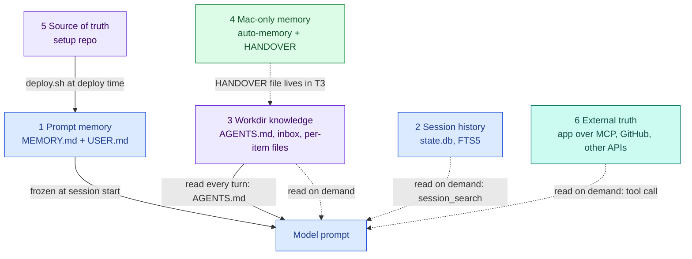
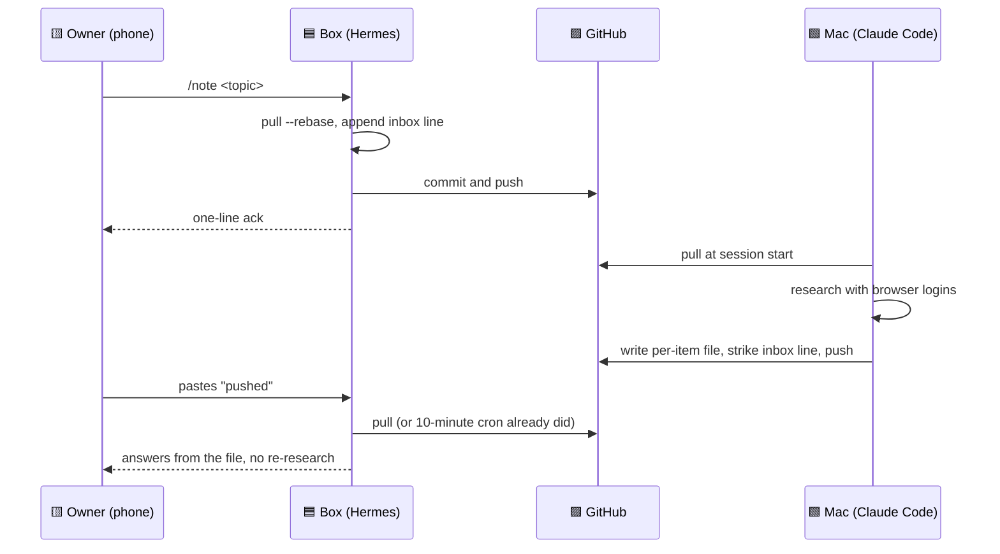

# Shared memory: git as the memory bus

Two agents on two machines never talk to each other. A Hermes profile on the box and a Claude Code session on the Mac read and write the same private git repo. Ownership is set per file or per section, and every line has a strict format. That repo is the only shared memory. The owner's phone only says "there is new work".



Colour shows where a tier lives: blue is the box, green is the Mac, purple is a GitHub repo, teal is a third-party service. Purple tiers are visible to both machines. A solid arrow is cost paid on every turn. A dashed arrow is cost paid only when read.

## The six memory tiers

Hermes terms used here: a **profile** is one isolated agent with its own config, bot and memory. `AGENTS.md` is a contract file in the profile's working directory that the agent reads every turn. A **skill** is a Markdown procedure the agent loads on demand.

| Tier | Where | Size or limit | Shared with the Mac? | Observed use |
|---|---|---|---|---|
| 1 Prompt memory | `MEMORY.md` and `USER.md` per profile, frozen into the system prompt | 2,200 and 1,375 chars | No | `MEMORY.md` held 0 to 3 lines per profile. No explicit `memory` tool call in any log. |
| 2 Session history | `state.db` per profile, SQLite with FTS5, `session_search` tool | 0.8 to 4.1 MB per profile | No | `session_search` was never called in 7 days. |
| 3 Workdir knowledge | A git repo per profile: `AGENTS.md`, inbox, per-item files, templates, caches | Tens of KB | Yes for two profiles, no for the other two | Where the facts live. Both agents write here. |
| 4 Mac-only memory | Claude Code auto-memory per project dir, plus a `HANDOVER` file in the repo | Small | Memory no, `HANDOVER` yes | Process knowledge, such as how to hand work to the box. |
| 5 Source of truth | The private setup repo: SOUL, config, skills, seeds, cron list, docs | n/a | Yes, cloned on both | Applied by `deploy.sh`. Skills are overwritten on deploy. |
| 6 External truth | A personal app over MCP, GitHub for the coding profile, other APIs for the rest | n/a | Yes, by API | For the rewards profile the app is the memory. |

Tier 1 costs 1 to 3% of a call. Tier 3 costs tokens only when a file is read.

## Ownership rules

Two writers on one file produce conflicts. Each file or section therefore has one owner. Other writers may only append to places marked as shared.

**Per file, in the private planning repo**

| Box writes | Mac writes |
|---|---|
| `inbox.md` lines, confirmations, the log, checklist ticks | Research pages, option comparisons, plan drafts, reference pages |

**Per section, in the private engineering-memory repo**

| Section | Writer |
|---|---|
| Facts, Journal | Box |
| Decisions | Mac |
| Backlog | Both |
| `→ Mac` hand-off | Box adds, Mac removes the line when it takes the work |
| `→ box` hand-off | Mac adds, box removes the line when it takes the work |

The taker removes the line. A line that still exists means the work is still open. No separate status field is needed. See [the AGENTS.md skeleton](../templates/AGENTS.example.md) and [inbox conventions](../templates/inbox-conventions.md).

## Line formats

Scripts parse these files. A free-text note breaks a parser and a human cannot tell what is handled. Exact formats fix both. Two generic examples:

```markdown
- 2026-10-21 12:04 · #research · <topic or link> · telegram
- ~~2026-10-20 09:15 · #idea · <topic> · telegram~~ → ideas/<slug>.md
```

```markdown
### → Mac
- <repo>: <what to do>, <acceptance check>, from box 2026-10-24
```

Rules that follow from this:

- One item per line, a timestamp first, a hashtag type second, the source last.
- Handled lines are struck through, never deleted, and point to the file that answers them.
- Each hand-off line names one action and one check.
- Pull with rebase before every write, then commit and push at once.

## The life of a fact



The cheap model step runs on the box. The expensive step, browsing with logins, runs on the Mac. The box never repeats the research.

## Why not a memory provider

Hermes supports pluggable memory providers. Nine official ones and two community plugins were evaluated on 2026-10-25. The verdict was no, for these reasons:

1. The real sharing problem is Mac to box, not session to session. Every Hermes memory provider is per profile and per Hermes home. None reaches a Claude Code session.
2. Markdown is diffable, greppable and reviewable on a phone. A vector store is none of these.
3. Privacy rules are auditable in a repo. They are not auditable inside a hosted memory graph.
4. Tier 3 knowledge costs tokens only when read. A provider adds a lookup before and a sync after every turn.
5. Isolation per profile is a rule. A shared provider would need to run once per profile.

Measured signals behind the verdict:

| Signal | Value |
|---|---|
| `MEMORY.md` fill | 0 to 25% |
| `USER.md` fill | 35 to 84% |
| `session_search` calls in 7 days | 0 |
| Memory share of one call | 1 to 3% |
| Spend, all profiles | about $10.7 list per week |

The only zero-dependency local provider is a SQLite one with FTS5 recall. It is kept as a fallback. The two community plugins either duplicate `grep` or add 41 tool schemas to a prompt whose largest fixed cost is already tool schemas.

## Triggers that would change the verdict

- A `MEMORY.md` at 80% or more for two audits, after facts were moved to workdir files.
- `session_search` is called and the log shows "not found" or the owner re-asking.
- A third always-on writer joins, such as a second box. Git still works, but locking becomes worth discussing.
- A profile needs cross-session reasoning over months, such as a trend over many sessions.
- The owner wants semantic search over the research corpus. Try `ripgrep` and an index file first.

## What was measured and the cheap upgrades chosen instead

Four upgrades, in order:

1. Mirror each profile's `MEMORY.md` into the shared repo when it changes. One `cp` in an existing commit. The Mac planner then sees facts that were only on the box.
2. Un-defer `session_search` in one profile with a real cross-session need, and let the audit watch for "not found".
3. Keep `USER.md` under 60% by moving owner-editable facts into workdir files.
4. Add an index file, not a database, when `inbox.md` or a card passes about 50 KB.

Related: [Workflows](04-workflows.md) shows the flows that move these files. [Decisions](07-decisions.md) records why.

## Sources and dates

Box inspection and a 7-day token audit on 2026-10-25. Prompt-size measurement on 2026-10-17. Provider evaluation on 2026-10-25. Hand-off counts from 2026-10-20 to 2026-10-25.
