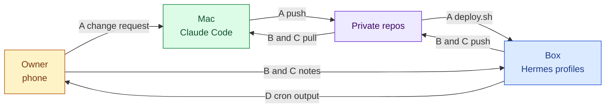
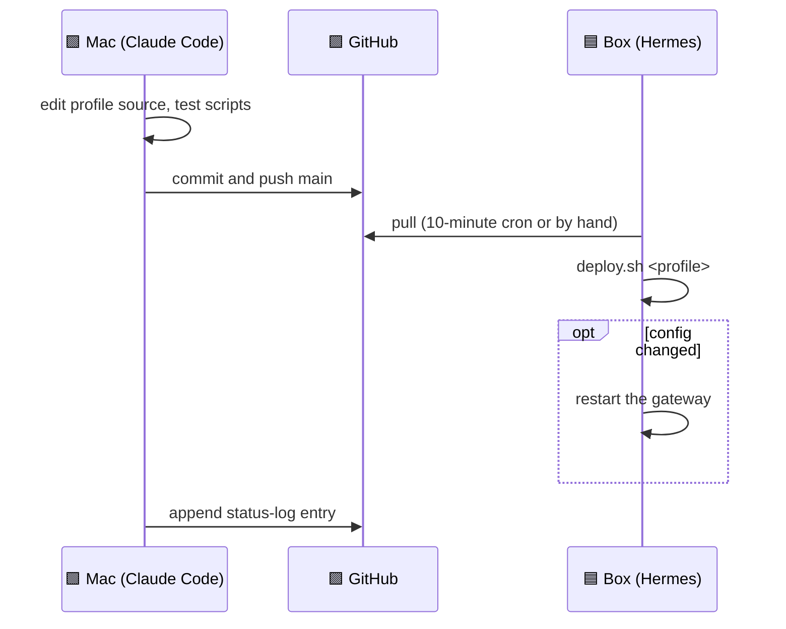
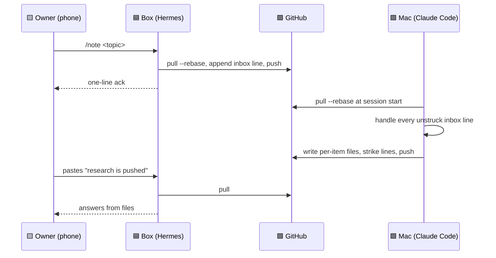
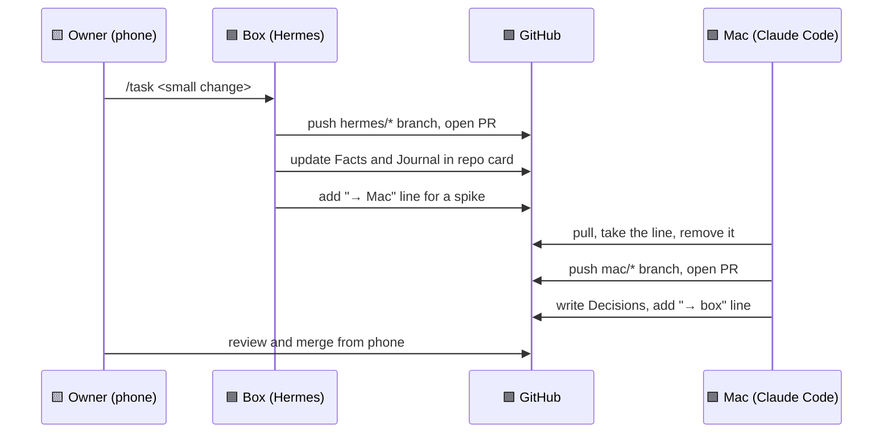
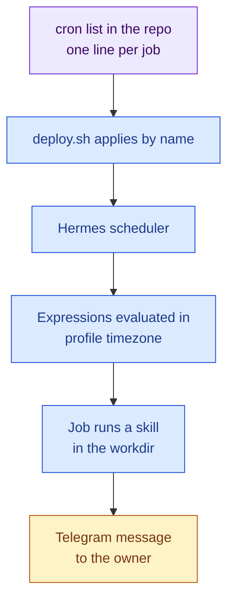

# Workflows

Four flows cover everything that happens in this system: deploy a change, research hand-off, engineering hand-off and scheduled jobs. Each flow moves Markdown through git. The owner's phone triggers the hand-offs. The memory model behind them is in [Shared memory](03-shared-memory.md). The profiles are described in [Profiles](02-profiles.md).

## A. Change a profile (Mac to box)

Steps:

1. Edit the profile source on the Mac. Test scripts with Python 3.12.
2. Commit and push to `main`.
3. The box pulls. The 10-minute cron does it, or an operator runs `git pull` by hand.
4. Run `deploy.sh <profile>`. It is idempotent. It creates the profile if missing, deep-merges `config.yaml`, copies SOUL and the USER seed, syncs skills with delete, seeds workdir files that do not exist, and applies the cron list by job name.
5. Restart the gateway only if config changed.
6. Append a status-log entry. Both machines append to it.

The contract between the repo and the script is in [the deploy contract](../templates/deploy-contract.md).

Observed cost: every distinct system prompt rewrites the cache prefix. Over 7 days one profile saw 9 distinct prompts and another 8. Cache writes were 49 to 81% of cost. Deploys are therefore batched.

## B. Research hand-off (box to Mac to box)

The Mac holds browser logins and a better model. The box captures in one turn and answers later from files.

Observed over five days:

| Measure | Value |
|---|---|
| Inbox lines | 15 |
| Handled | 11 |
| Plans completed | 2 |
| Rejected pushes | 2, recovered by the pull-then-push rule |
| Conflicts | 0 |

## C. Engineering hand-off (both directions)

Rules:

- The box does PR-sized tasks on `hermes/*` branches.
- The Mac does spikes and migrations on `mac/*` branches.
- Neither pushes to a default branch. The owner merges.
- Each side edits only the card sections it owns, per [Shared memory](03-shared-memory.md).

Cron jobs on the box: a weekly discover job, a weekday PR digest, a weekly health check and a monthly audit. A dependency job is defined and paused.

Observed: about 20 PRs were opened or merged in two Mac hand-off runs.

## D. Scheduled jobs

A **cron job** in Hermes is a stored schedule that runs a skill and delivers the result to chat.

Apply by name makes a redeploy skip a job that already exists instead of duplicating it. To change a job, delete it on the box and redeploy. See [the cron example](../templates/cron.example.txt).

The timezone lesson: Hermes evaluates cron expressions in the profile timezone, so a schedule pre-converted to UTC fires at the wrong hour. Details in [Lessons](08-lessons.md).

## E. Keeping clones fresh

| Direction | Mechanism | Latency |
|---|---|---|
| Mac to box | `git pull --rebase` at the start of each skill procedure | Immediate when a skill runs |
| Mac to box | Crontab fast-forward of three clones, ff-only, skips dirty or diverged clones and logs | 10 minutes at most |
| Box to Mac | `git pull --rebase` at the start of each Mac session | Next Mac session |
| "New work exists" | Owner pastes a line into the bot, or starts a Mac session | Manual |

The owner is the message bus. Nothing notifies the other machine on push. The 10-minute cron removes the stale-answer case when the paste is forgotten.

## F. Observability

| Tool | What it gives |
|---|---|
| Token audit script, read-only | Per-profile calls, list cost, prompt size, memory fill, prompt-hash churn |
| Token audit skill | The same audit on request, with thresholds and flags |
| Dated baselines | A measurement file per audit, from 2026-10-17 |
| Status log | Newest entry first, appended by both machines |
| Sync log on the box | One line per fast-forward or skip |

Baselines: about $3.5 list per day for one active profile on 2026-10-17, about $10.7 list per week for all profiles on 2026-10-25.

## Sources and dates

Workflows observed from 2026-10-17 to 2026-10-29. Hand-off counts from 2026-10-20 to 2026-10-25. Token audits on 2026-10-17 and 2026-10-25.
