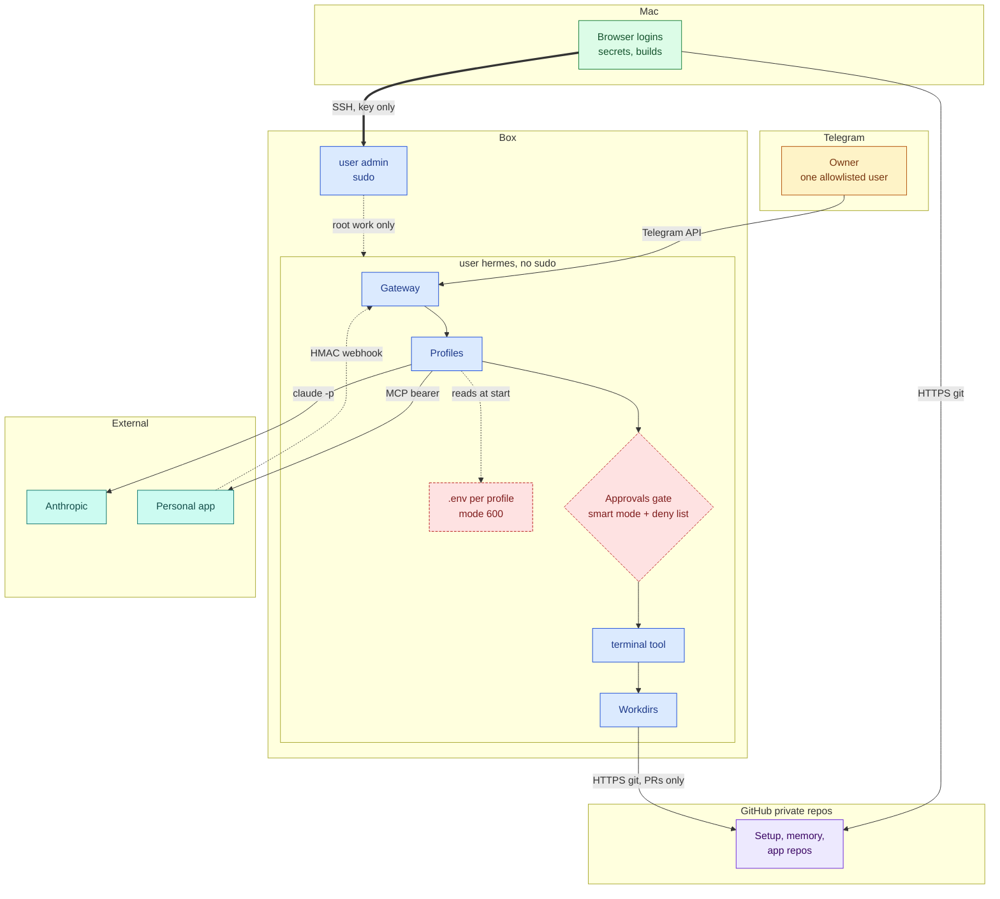

# Security model

An always-on agent with shell access is a standing remote-code-execution target that happens to speak English. This box is small, owner-only and cheap, so the model leans on few moving parts. Nothing listens except SSH, secrets stay on the box, and risky commands pass a gate that the agent cannot switch off.

Dashed red nodes are secret stores or controls. The gate sits between the model's tool request and the shell. Builds, browser sessions and credentials for other services stay on the Mac.

## Threat model in one paragraph

The asset is a shell on a VPS that holds a Claude login, bot tokens and clones of private repos. The likely attacks are an exposed port, a stolen bot token that lets a stranger talk to the agent, a prompt injection inside a web page or an email, and the agent making a destructive mistake on its own. The owner is the only intended user. The design assumes the model can be tricked, so the controls sit outside the model.

## Trust boundaries

| Boundary | Trusted side | Untrusted side | Control |
|---|---|---|---|
| Internet to box | Nothing | Everything | SSH only, key login. |
| Telegram to gateway | One user id | Any other sender | Allowlist of exactly one user per bot. |
| Model to shell | Hermes tools | Model output | Approvals gate and deny list. |
| Box to GitHub | Pull requests | Default branches | Pre-push hook and deny globs. |
| Box to Mac | Git commits | Everything else | No direct channel. |
| Web content to agent | The owner's instructions | Page text, emails, issues | Skills mark fetched text as data, not instructions. |

## Layers

| Layer | Mechanism | What it stops |
|---|---|---|
| Network | SSH is the only inbound service. A cloud firewall allows 22/tcp and ICMP. The host runs ufw with a rate limit on 22. fail2ban watches SSH. | Port scans, exposed databases, brute force. |
| OS | The agent runs as an unprivileged user without sudo. Root work uses a separate `admin` account. | A compromised agent installing software or reading other users' files. |
| Secrets | Each profile has a `.env` at mode 600, written by `gateway setup` on the box. The repo holds placeholders that are filled at deploy. | Tokens leaking through git, chat or logs. |
| Chat | One bot per profile. The allowlist holds exactly one user. | A stranger who finds a bot handle. |
| Agent | Approvals gate with `mode: smart`. A `deny` glob list blocks commands unconditionally, even under `/yolo`. `cron_mode: deny` applies to autonomous crons. A `smart_policy` text escalates domain actions. | Destructive git, repo deletion, silent transactions, unattended risky work. |
| Data | Per-domain PII rules sit in `SOUL.md`, `AGENTS.md` and the Mac-side `CLAUDE.md`. | Personal data spreading into repos and logs. |
| Supply chain | Skills are overwritten from the repo on deploy. `skills.write_approval` stages self-edits instead of applying them. Box clones commit under a dedicated identity. A pre-push hook refuses default-branch pushes. | A self-modifying agent drifting, and unreviewed code reaching production. |

### The agent layer in detail

The gate has three outcomes. It allows a command, asks the owner in Telegram, or denies. In `smart` mode a small policy decides what to ask about. The deny list is plain glob patterns and is checked first. The agent gains nothing by editing it: every deploy re-applies the list from the repo and the gateway must restart to read a changed config.

| Rule | Examples | Profile |
|---|---|---|
| Deny glob | Force push, repo delete, `git reset --hard` | All coding and travel profiles |
| Deny glob | Merge or close a pull request, default-branch push | Coding profile |
| Deny glob | Build commands, publish, deploy tools | Coding profile |
| Smart policy | Paying, submitting a form, logging in to a vendor | Travel profile |
| Smart policy | Database clients pointed at a non-localhost host, migrations, branch deletion, repo settings, new dependencies | Coding profile |
| Cron mode | `deny` for crons that run without the owner | Profiles with autonomous crons |

The travel profile researches and drafts. The owner completes any transaction in their own browser. The coding profile opens pull requests and never merges them. Templates for the block are in [profile config template](../templates/profile-config.example.yaml).

### Data rules per profile

| Profile | Rule |
|---|---|
| `travel` | Never stores document numbers. |
| `rewards` | Never stores personal data in the workdir. The app is the memory. |
| `career` | Sensitive source material stays on the box only and is never committed. |
| `vibecoder` | No secrets in code or chat. Local databases only. |

## What is deliberately not done

| Choice | Reason |
|---|---|
| No Docker | Membership of the docker group is root-equivalent, so it would undo the no-sudo rule. |
| No API keys on the box | The only model route is the subscription login. There is no key to leak or to bill. |
| No inbound ports besides SSH | The gateway polls Telegram outbound. Nothing needs to accept connections. |
| One planned exception | A webhook from the personal app, reached only through a Tailscale Funnel to a loopback port, signed with HMAC. Tailscale is a personal tailnet, never a work one. |
| No auto-submit, no scraping | The career profile never submits anything on the owner's behalf and never scrapes third-party sites. |

## Known gaps

- Runtime state on the box (`state.db`, memory files, crons created at run time, the two local-only workdirs) has no backup yet. The source of truth is in git. The history is not.
- The owner relays messages between Mac and box by hand. This is safe but slow and easy to forget.
- All profiles share one Claude login and one usage window. A runaway cron in one profile can starve the others.
- The webhook path is planned and not yet live. Its threat model is untested.
- The pre-push hook is installed into each managed app clone when the coding profile adopts a repo. The two shared memory repos rely on the pull-then-push rule instead, since both machines write to their default branch by design.

See [Lessons](08-lessons.md) for incidents and [Decisions](07-decisions.md) for the reasoning behind these choices. For the whole system picture, see [Architecture](01-architecture.md). Per-profile detail is in [Profiles](02-profiles.md) and [Shared memory](03-shared-memory.md). The deploy flow that fills placeholders is in the [deploy contract](../templates/deploy-contract.md).

## Sources and dates

Facts observed between 2026-10-07 and 2026-10-29. Firewall and account setup from 2026-10-16. Approvals blocks read from the deployed profile sources on 2026-10-22 and 2026-10-29.
