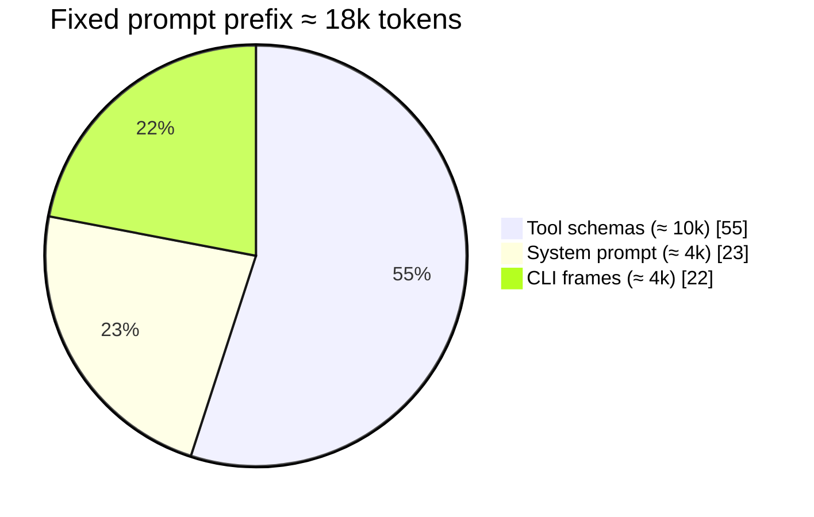
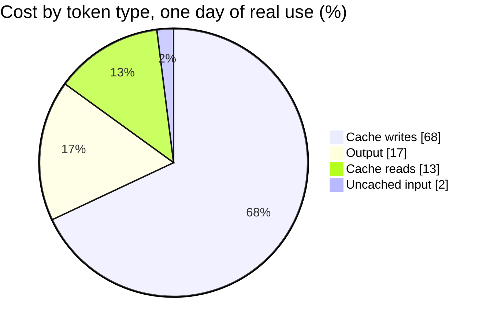

# Token economy

Every profile bills one Claude Max subscription through the Agent SDK rate, and all profiles share one 5-hour usage window. The design therefore treats prompt size as a budget and measures it. The measurements below come from the box logs, not from estimates.

## What a call costs

Each model call carries a fixed prefix of about 18k tokens before the first user word. The Claude Code CLI wraps every turn in its own frames, about 4k tokens, which the box cannot change. Tool schemas are the largest part. The system prompt is what the owner writes: skills index, SOUL.md (the persona file), AGENTS.md (the per-workdir contract read every turn), guidance, USER.md and MEMORY.md.

Cache writes dominate cost at 68%. Any change to the prefix forces the cache to be rewritten. One active profile cost about $3.5 list for a day of use on 2026-10-17, roughly 1.3% of a 5-hour window.

## Where the prefix comes from

| Part | Size | Lever |
|---|---|---|
| Tool schemas | 41 KB, ≈ 10k tokens | Defer rarely used tools with `tools.tool_search.defer`. The model sees a one-line catalog entry and loads the full schema on demand. |
| System prompt | 23 KB, ≈ 4k tokens | Skills index 5.7 KB, SOUL 4.6 KB, AGENTS.md 3.9 KB, guidance 3.8 KB, USER 1.3 KB, MEMORY 0.9 KB. Keep SOUL and AGENTS.md stable. Put volatile facts in files read on demand. |
| CLI frames | ≈ 4k tokens | Fixed. |

Six heavy core tools are deferred per profile. They stay callable. The cost moves from every call to the calls that need them.

## Memory is not the token driver

The two prompt-memory files total 2.2 KB, about 550 tokens. That is 1% to 3% of a call. Raising the memory caps would add fixed cost to every call for facts that belong in files. See [Shared memory](03-shared-memory.md) for where facts live instead.

## Decisions taken

| Date | Decision | Reason |
|---|---|---|
| 2026-10-17 | Keep the two-file memory plus workdir files | Memory is 1% to 3% of a call. |
| 2026-10-17 | Defer six heavy core tools per profile | Tool schemas are 55% of the prefix. |
| 2026-10-17 | Idle compaction after 1800 s | Long sessions grow history; the ratio trigger never fires. |
| 2026-10-17 | Post-turn background review off where state lives in files | It replays the whole conversation. It was 15% of one profile's cost. |
| 2026-10-17 | Keep the default model everywhere | One model keeps the cache prefix shape identical. |
| 2026-10-17 | No external memory provider | A provider adds a prefetch and a sync on every turn. See [Decision records](07-decisions.md). |

## The audit loop

The loop has four parts.

1. A read-only script measures per-profile calls, tokens and list cost from the logs. It never opens `.env`.
2. A Claude Code skill on the Mac runs the script, interprets the output and proposes fixes.
3. The owner approves or rejects each fix. Nothing changes on the box without that step.
4. Dated baselines are kept, so a change can be compared with the run before it.

Two alarms are checked on every run.

| Alarm | Threshold |
|---|---|
| A MEMORY.md file | Over 80% of its cap |
| One day of use | Over 20% of a 5-hour window |

The loop also flags prompt-hash churn, USER.md fill and long average prompts. See [Lessons learned](08-lessons.md) for what those flags found. A config sample lives in [profile-config.example.yaml](../templates/profile-config.example.yaml).

## Observed numbers

Seven days to 2026-10-25, all profiles.

| Measure | Value |
|---|---|
| List cost per week, all profiles | ≈ $10.7 |
| Share of the "20% of a window per day" alarm | Well under |
| Average prompt, two chatty profiles | 59k and 65k tokens per call |
| Distinct system prompts per profile per week | 4 to 9 |
| MEMORY.md fill | 0% to 25% |
| USER.md fill | 35% to 84% |
| `session_search` calls | 0 |

Chatty profiles grow because Telegram sessions run for days. The 0.5 compaction ratio never fires on a 1M-token window. Each distinct system prompt rewrites the cache prefix, so frequent deploys cost real tokens.

## What is next

| Change | Expected effect |
|---|---|
| Compression threshold at 80k tokens in the two chatty profiles | Compaction fires before history reaches the window ratio. Verify in logs after a day. |
| Batch deploys, one run per day per profile | Fewer prefix rewrites. |
| `/new` per topic from the phone | Short sessions, smaller prompts. |

## Sources and dates

Prompt-size and cost split measured 2026-10-17 from one day of logs. Weekly numbers measured 2026-10-25 over seven days. Decisions dated 2026-10-17. Open items checked 2026-10-29.
