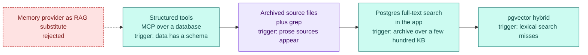

# Decision records

Six decisions shaped the system. Each is recorded with context, choice, consequences and the date, in ADR style. The retrieval ladder below summarises the one decision that is deliberately deferred.

## ADR-1 Model access through the subscription plugin, not an API key

### Context
The owner has one Claude Max subscription. Cost must be predictable. No key should sit on an internet-facing box.

### Decision
Hermes calls Claude through the DirectSDK plugin, which runs the Claude Code CLI in print mode. Billing goes to the subscription. No API key exists anywhere on the box.

### Consequences
- Hermes' own tools do the work. Claude Code's native tools are disabled.
- All profiles share one 5-hour window. See [Token economy](06-token-economy.md).
- No embedding or batch API route exists on the box, by design.

### Date
Decided at setup, confirmed 2026-10-17.

## ADR-2 A cheap VPS, not local hardware

### Context
A hardware report compared Mac minis, mini PCs and a DGX-class box against a VPS with 2 vCPU and 4 GB RAM at about $8/month. Power is a rounding error. Only used x86 hardware reaches cost parity.

### Decision
The VPS stays the gateway. The Mac does heavy work: browsers, builds, long research.

### Consequences
- 4 GB RAM rules out local embedding models and extra daemons.
- A home worker can join later over a private network without moving the gateway.
- The trigger to revisit is the loss of the cheap VPS line, not a hardware price.

### Date
2026-10-17.

## ADR-3 Two-file prompt memory plus git workdirs, no memory provider

### Context
Measured signals on 2026-10-25:

| Signal | Value |
|---|---|
| MEMORY.md fill | 0% to 25% |
| USER.md fill | 35% to 84% |
| `session_search` calls | 0 |
| Explicit memory tool calls | 0 |
| Memory share of a call | 1% to 3% |

Hosted and local providers are per profile and none syncs to a Mac session. Git does.

### Decision
Keep the built-in two files per profile. Put bulky knowledge in Markdown files inside git workdirs, with ownership rules per file or per section.

### Consequences
- Facts are diffable, greppable and reviewable on a phone. See [Shared memory](03-shared-memory.md).
- Re-check at every audit against these triggers: MEMORY.md at 80% for two audits, `session_search` showing recall failures, a third always-on writer, or a need for cross-session reasoning over months.

### Date
2026-10-17, re-confirmed 2026-10-25.

## ADR-4 No RAG today, a ladder when needed

### Context
Every corpus checked is tens of KB and addressed by name. The finance app answers with typed MCP tools over SQL, which is more precise than embeddings. Session history is searchable with built-in full-text search that is never called.

### Decision
Climb only when the lower rung fails. Structured tools first. Archived source files with grep second. Postgres full-text search in the app third. pgvector last, with embeddings computed on the Mac.

### Consequences
- Zero infrastructure now.
- A set of 20 real questions decides whether embeddings are ever needed.
- A memory provider is not a substitute: providers index conversations, not documents.

### Date
2026-10-25.

## ADR-5 The coding agent is PR-only

### Context
The engineering profile holds a GitHub token and works on seven private repos that deploy from their default branch.

### Decision
- The agent works on `hermes/*` branches and opens PRs from a template.
- The owner merges from the phone.
- Merge, close, force-push and delete sit on the unconditional deny-list.
- A pre-push hook is a second layer.
- No builds and no non-localhost databases run on the box.

### Consequences
- Every box change is reviewable and reversible.
- Heavy work goes to the Mac. See [Security](05-security.md).

### Date
2026-10-22.

## ADR-6 One repo as source of truth with an idempotent deploy

### Context
Two machines write to the system, and the box is reconfigured many times a week.

### Decision
Profile sources live in one private repo. A deploy script applies them by rsync, deep merge of config, seed-if-missing for workspace files, and crons applied by name. The repo owns skills. Box self-edits to skills are staged for approval.

### Consequences
- The box is disposable except for runtime state: memories, session database, run-time crons and local-only workdirs.
- That state has no backup. It is the known gap. See [Lessons learned](08-lessons.md).

### Date
2026-10-17 to 2026-10-22.

## Rejected alternatives

| Alternative | Reason |
|---|---|
| Hosted memory providers | Personal data leaves the box and each needs a key. |
| A 41-tool local memory plugin with an embedding model | Tool schemas are already the largest prompt cost, and the model needs RAM the box lacks. |
| Raising memory caps | Fixed cost on every call for facts that belong in files. |
| A third shared repo for cross-profile knowledge | Isolation per profile is a rule and no profile asked. |
| Moving the gateway to the Mac | The VPS is the cheapest always-on option. |
| Docker on the box | The docker group is root-equivalent and the agent user has no sudo. |

## Sources and dates

Measurements from 2026-10-17 and 2026-10-25. Decisions dated 2026-10-17 to 2026-10-25. Hardware survey read 2026-10-17.
