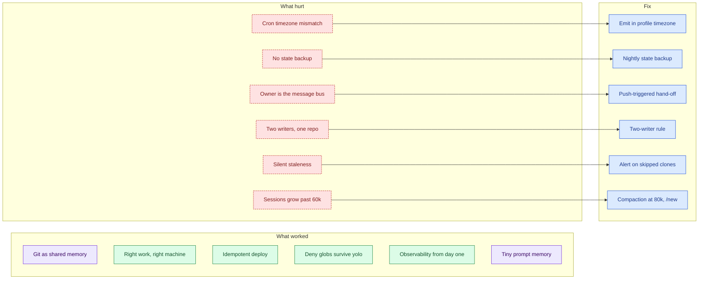

# Lessons learned

After three weeks of real use, some choices held up and some hurt. This page lists both with the evidence and the fix, so the next person builds the plumbing first.

## What worked

- **Git as shared memory.** Both agents read and write Markdown with strict line formats. In five days there were 2 rejected pushes and 0 conflicts.
- **Right work on the right machine.** Browsers, logins, builds and secrets stay on the Mac. The box does one-turn captures and scheduled jobs. The two busiest profiles cost about $3 to $5 list per week.
- **Idempotent deploy.** Re-running it is safe. Box-written config keys survive. Seeds never clobber.
- **Deny globs that survive yolo.** The approvals gate can be bypassed for a session. The deny-list still holds. See [Security model](05-security.md).
- **Observability from day one.** An audit script, dated baselines, a status log and a sync log made every later finding measurable.
- **Deliberately tiny prompt memory.** The decision to keep facts in files held up. See [Token economy](06-token-economy.md).

## What hurt

| Finding | Evidence | Consequence | Fix |
|---|---|---|---|
| Cron expressions emitted in UTC, scheduler evaluates in the profile timezone | Found and fixed in the coding profile on 2026-10-22, missed in the travel profile | Latent, because all travel jobs were paused. Reminders would fire hours off. | Emit in the profile timezone. Re-create jobs before unpausing. |
| Runtime state on the box has no backup | Memories, session database, run-time crons and two local-only workdirs exist only there | A disk loss means redoing intake and recreating crons by hand | Nightly state backup. Give local-only workdirs a private remote. Regenerate crons from a data file. |
| The owner is the message bus | Hand-offs between Mac and box are pasted into Telegram by hand | One manual step per hand-off. Stale answers when forgotten. | Fixed one-line hand-off format now. Push-triggered webhook later. |
| The setup repo gained a second writer and diverged | Box committed while the Mac had uncommitted edits. Newest-on-top status log in one file. | Pulls fail or conflict | Two-writer rule. Shorter status files per month. |
| Silent staleness when a clone is skipped | The sync job skips dirty or diverged clones and only logs | A bot answers from an old pack with no alert | Write an alert marker after one hour. Daily skills report it. |
| Telegram sessions reach 60k+ tokens per call | 59k and 65k averages. Compaction never fired. | Cache-write heavy turns | Threshold at 80k tokens. `/new` per topic. |
| Prompt-prefix churn from frequent deploys | 8 to 9 distinct system prompts in a week for two profiles | Each one rewrites the cache prefix | Batch deploys. |
| A seed USER.md at 84% of its cap | Audit flag, 2026-10-25 | First background write fails or truncates | Move owner-editable facts to workdir files. Seed under 60%. |
| Memory tiers partly invisible across machines | Box prompt memory is unseen by the Mac. Mac auto-memory is unseen by the box. | Drift once content accumulates | Mirror prompt memory into the shared repo in existing commits. |
| The audit skill's provider notes went stale | They named two providers; the official page lists nine | A future escalation would start from the heaviest option | Rewrite the notes from the provider table. |

## Practices adopted

- **Two-writer rule.** Every session starts with `git pull --rebase --autostash`. Box-side commits announce themselves in the status log.
- **Batch deploys.** One deploy per profile per day. Never deploy a SOUL edit alone.
- **Weekly 10-minute ritual.** Run the audit. Read the sync log. List cron jobs. Archive struck inbox lines.
- **One owner-TODO list** at the top of the handover file, instead of four.
- **Finish or park a half-deployed profile.** A parked profile has paused crons and no bot token.

## What I would do differently on day one

- Build the state backup before the first profile.
- Treat cron timezone as a tested property, with a check that prints the next run time.
- Write the hand-off trigger first. A pasted line is a bug waiting to be forgotten.
- Split the status log by month from the start.
- Set the compaction threshold on day one. The default ratio assumes a smaller window.

See also [Decision records](07-decisions.md).

## Sources and dates

Findings observed 2026-10-17 to 2026-10-29. Weekly audit numbers from 2026-10-25. Some fixes were still open on 2026-10-29.
